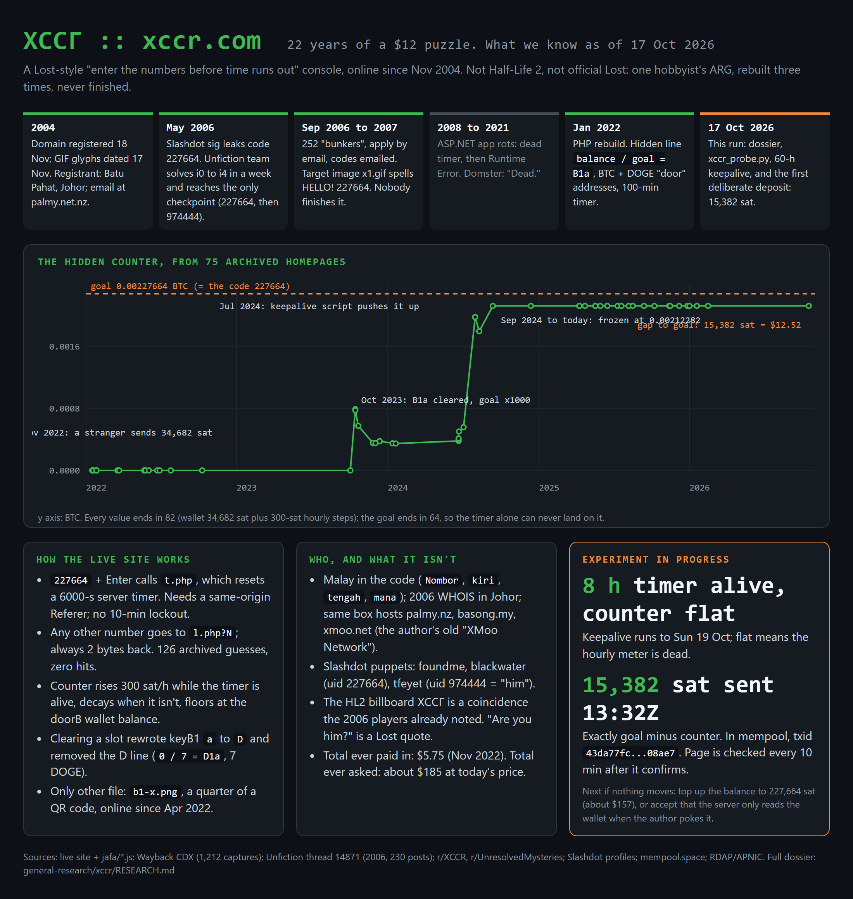
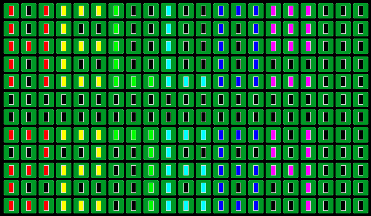
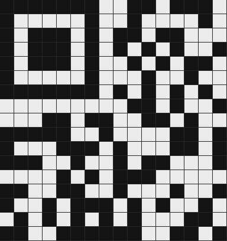

# xccr.com — a teardown of a 22-year-old ARG

> **TL;DR** [xccr.com](https://xccr.com) is a cryptic "enter the numbers before time runs
> out" console that has been online since **November 2004**. For two decades people have
> called it an unsolved Half-Life 2 ARG. It is neither unsolved nor Half-Life: it is one
> hobbyist's Lost-inspired puzzle, rebuilt three times and quietly abandoned. This repo is
> the first full teardown — mechanics, authorship, a reconstructed state model, a live
> experiment (we put money in to test a hypothesis), and all the raw data so you can check
> every claim yourself.

<p align="center">
  
</p>

---

## What it is, in one paragraph

A black terminal with a green `>:` prompt. Type the number **227664** and press Enter; a
server-side 100-minute countdown appears. Select the page text and a hidden line shows
`0.00212282 / 0.00227664 = B1b`. The HTML `<head>` carries a Bitcoin address, a Dogecoin
address, and four "key" alphabet rows. That is the entire modern site. Everything else —
the Cyrillic title `ХССГ`, the Half-Life billboard rumor, the "ARE YOU HIM?" message — is
either backstory or coincidence. The sections below separate the two.

## What it is *not*

- **Not Half-Life 2.** A City 17 billboard reads `ХССГ`, and that is the whole basis for the
  rumor. HL2 shipped 16 Nov 2004; the domain was registered 18 Nov 2004; the site's GIFs are
  dated 17 Nov 2004. The 2006 solvers already noticed the billboard and dismissed it. The
  name likely came *from* the game; nothing points the other way.
- **Not The Lost Experience.** The console, the 100-minute timer, and "Are you him?" are
  lifted from *Lost* (Desmond in the hatch), but this was a fan homage, never an official ABC
  property. The 2006 community established this and moved on.
- **Not unsolved.** The 2006 puzzle chain *was* solved (see Era 1). The modern version isn't
  "unsolved" so much as **abandoned** — its progress mechanism is a server job that stopped
  running in September 2024.

## Who is behind it

No name, but the cluster is unambiguous from public records:

- **2006 WHOIS** (preserved in the Unfiction thread): registrant in **Batu Pahat, Johor,
  Malaysia**, admin contact `xccr@palmy.net.nz`, nameservers `ns3/ns4.kiwihosting.net.nz`.
- The **same server IP** (103.7.11.66, Exabytes Singapore, Plesk) hosts **palmy.nz**
  ("Palmerston North, New Zealand"), **basong.my** (a registered Johor company), and
  **xmoo.net** — which from 2004–2021 was the **"XMoo Network,"** a hobby web network by the
  same person (IMooU messaging, a "Batu Pahat Online Portal," Auckland/Wellington/Christchurch
  map directories).
- **Malay in the code**: `Nombor` (number), `kiri`/`tengah` (left/middle, in the old RSS
  feed), `mana` (where). The script folder is named **`jafa/`** — NZ slang for an Aucklander.
- **Slashdot puppet accounts** seeded the 2006 game: `foundme` (bio "Do you readme.txt?", sig
  "Please stop entering code 2,2,7,6,6,4"), `blackwater` (user id **227664**), and `tfeyet`
  (user id **974444**, revealed in-game as "him").

Read together: a Malaysian-Chinese hobbyist developer from Batu Pahat, living in New Zealand,
who has paid for one small VPS to keep this running for 22 years.

---

## The three eras

### Era 1 — 2004–2006: the *Lost* console (ASP.NET / IIS)

Enter `227664` to reset a 99-minute timer, bump a decimal counter, and sometimes receive
1–4 **keys** (N/S/E/W) to move on a hidden 10×10 room grid. State was partitioned by IP block
("your designated server" in `readme.txt`). A week-long puzzle chain (`i0`–`i4`) led, via
screenshots interleaved at 5-pixel intervals and column-shift steganography, to the message
**"HE IS THE CODE ON SLASHDOT"** and ultimately to Slashdot user `tfeyet` (uid 974444). The
Unfiction team **reached the checkpoint** by entering `227664` then `974444` on 25 May 2006.
The puppet-master never contacted the winners, and the game stalled. The full 230-post thread
is in [`evidence/unfiction_thread_2006.txt`](evidence/unfiction_thread_2006.txt).

### Era 2 — 2006–2008: the bunkers

The homepage became a 21×12 grid of **252 "bunkers"** you applied for by email; a code was
emailed and had to be entered within 24 hours. The target image `x1.gif` (below) spells
**"HELLO!"** then **"227664"** in a 3×5 pixel font, one color per glyph — decoded here for the
first time. The community never reconstructed it. By 2008 the ASP.NET app was dead; by
2016–2021 it threw a runtime error.

<p align="center"></p>

### Era 3 — 2022–present: the "doors" console (PHP / Plesk)

A from-scratch PHP rebuild, same GIF assets, far simpler. Enter `227664` → `GET t.php` resets
a 6000-second server timer. Any other number → `GET l.php?<n>`, which always returns two bytes.
The hidden line and the `<head>` keys are the whole puzzle surface. This is the live site, and
the rest of this document is about reverse-engineering it.

---

## The reverse engineering

### The hidden counter, and what it actually tracks

We pulled every distinct archived homepage (75 of them) and extracted the counter at each
point — the script is [`xccr_probe.py wayback`](xccr_probe.py), the series is
[`data/wayback_series.json`](data/wayback_series.json):

| date | hidden line | keyB1 |
|---|---|---|
| 2022-01 → 2023-10 | `0.00000000 / 0.00000227 = B1a` (+ `0 / 7 = D1a`) | `abcdefghijklm` |
| 2023-10-15 | `0.00079082 / 0.00227664 = B1b` | **`D`**`bcdefghijklm` |
| 2023-10 → 2024-01 | decays to `0.00034682`, sits there | |
| 2024-06 → 07 | climbs to `0.00197882` (someone's keepalive script) | |
| 2024-09-12 → now | **frozen at `0.00212282`** | |

Three things fall out:

1. **Every counter value ends in `…82`** = the wallet's `34,682` sat plus 300-sat steps. The
   goal ends in `…64`. **The timer alone can never land on the goal** — a deposit is
   structurally required. This had never been computed.
2. The counter **rises ~300 sat/hour while the timer is alive, decays when it isn't, and
   floors at the Bitcoin wallet balance** (confirmed on-chain, [`data/chain.jsonl`](data/chain.jsonl)).
3. It has not moved since September 2024 despite the timer being kept alive — the hourly
   accrual job is dead.

### The experiment: we put money in

The cleanest way to tell "intended deposit" from "dead cron" apart was to make the deposit and
watch. On 2026-10-17 we sent exactly **15,382 sat** (≈ $12.50, the gap to the goal) to the
doorB address `1G9rG47hF8ckTT6icgHFV3qWBDPjkj4wME`
([tx `43da77fc…`](https://mempool.space/tx/43da77fcd4911557629f389d1872d623e8ef1365e6d762286a36e5b14d308ae7),
confirmed in block 971869). Then we held the timer alive for 24 hours and snapshotted the page
every 10 minutes ([`data/state.jsonl`](data/state.jsonl), [`data/trigger.jsonl`](data/trigger.jsonl)).

**Result: no change.** And the Wayback series explains why — it settles the counter model:

- During **B1a**, the wallet already held 34,682 sat for 11 months while the counter read
  `0.00000000`. So the counter is **not** the live balance.
- The **B1b floor equals the wallet balance at the exact moment of the Oct-2023 slot
  transition.** The author relaunched the slot then and seeded the floor from the balance.

**Conclusion: the wallet is read once, at an author-triggered slot transition — not live.**
Our deposit can only matter if the author ever starts a new slot, at which point the new
balance (50,064 sat) becomes the next floor. There is no player-side action that advances the
current slot. The $12 bought a clean negative result, which is the point of an experiment.

### The keys are a message, not a cipher

The four `keyB*` rows concatenate into a 52-character buffer over `a…z A…Z`. In 2022 it was
the identity alphabet. **Solving B1a overwrote position 1: `a` → `D`.** So a slot name `B1x` =
door B, key-row 1, character position *x* (a=1, b=2, …), and each solved slot overwrites one
character. Read in order, the slots **spell a word**. We have the first letter: **`D`**. The
"wallet address" is doubling as the buffer being overwritten. This mechanic is undocumented
anywhere else.

### The QR code (`b1-x.png`): real, cropped on purpose, and unrecoverable

The only other asset is a partial QR. We did a clean module extraction (finder and timing
patterns intact → [`data/qr_grid.npy`](data/qr_grid.npy)) and decoded the format-info block:
it is a **valid** format — **ECC level H, mask pattern 6**. A decorative fake would not carry
self-consistent format bits, so this is a genuine QR the author deliberately cropped.

<p align="center"></p>

It cannot be brute-reconstructed from this image, and not for lack of effort:

- It is the top-left **~⅓** of a ≥29×29 symbol.
- QR data is placed bottom-right → up, so the **mode indicator, length, and start of the
  message are in the missing corner**; what we hold is the padding tail.
- ECC-H corrects ≤22 erased codewords per block; we are missing ~2× that. **This is an
  information-theoretic wall, not a tooling gap.** Brute-forcing versions/masks does not add
  back data that isn't present.

It becomes solvable only if another quadrant (`b2-x`, `b1-y`, …) is ever uploaded — the
`assets` watcher catches that — or a less-cropped capture surfaces.

### Odds and ends we ruled out

- **`favicon.ico` "second layer"** (a 2006 loose end): it is the stock Windows document icon.
- **Sister sites** share the identical HTML template but carry **none** of the door/key/counter
  machinery. The game lives only on xccr.com.
- **`l.php` guesses** — the `contact` meta digits (`12345678`, …) and the era-1 Slashdot IDs
  (974444, 975093, 897346) — all return the 2-byte baseline.

---

## Methodology / reproduce it yourself

Everything here is stdlib Python plus the public web. The monitor is one file,
[`xccr_probe.py`](xccr_probe.py):

```bash
python xccr_probe.py snapshot      # fetch + parse the live page, diff vs last run
python xccr_probe.py wayback       # rebuild the counter time series from the Internet Archive
python xccr_probe.py chain         # BTC (doorB) + DOGE (doorD) balances, on-chain
python xccr_probe.py assets        # hash every file in /images/ and /icons/, diff vs manifest
python xccr_probe.py dirs          # probe plausible sibling paths
python xccr_probe.py trigger --mode referer   # measure how t.php resets the timer
python xccr_probe.py keepalive --every 30 --hours 60   # hold the timer alive, watch for change
python xccr_probe.py lphp --list candidates.txt        # try structured code guesses on l.php
```

It keeps all state in `data/` as append-only JSONL, so every run is a diff against the last.
`t.php` only resets the timer with a same-origin `Referer` header; the probe handles that.

**Note on ethics / scope.** This repo only ever makes ordinary HTTP GETs to a public site and
reads public blockchain + Internet Archive data. It does **not** attempt the server's admin
panel, mail, or FTP, and it does not brute-force credentials. The one real-world action was a
single small on-chain donation to a wallet the site itself advertises, made to test a
documented hypothesis.

## Data & evidence

| path | what |
|---|---|
| [`FINDINGS.md`](FINDINGS.md) | the dense working dossier (everything, with sources) |
| [`xccr_probe.py`](xccr_probe.py) | the monitor/analysis tool |
| [`data/`](data/) | JSONL state logs, the counter time series, the QR module grid |
| [`evidence/`](evidence/) | contact sheets, the decoded `x1.gif`, the QR render, the infographic |
| [`evidence/unfiction_thread_2006.txt`](evidence/unfiction_thread_2006.txt) | the full 2006 Unfiction thread (230 posts) |
| [`evidence/wayback_homepages/`](evidence/wayback_homepages/) | 90 archived homepage captures, 2008–2026 |

## Sources

Live site + `jafa/*.js`; Internet Archive CDX (1,212 distinct captures); the restored Unfiction
thread *[XCCR] Trailhead* (2006); r/XCCR, r/UnresolvedMysteries, r/ARG; Slashdot profiles;
mempool.space; RDAP (Verisign) and APNIC. The fan wiki at craftworks.top/xccr was a useful
starting point; where it is wrong (the QR upload date, "offline 2016–2022," the counter
behavior), `FINDINGS.md` says so.

## License

Findings and text: CC BY 4.0. Code: MIT. Do what you like; a link back is appreciated.
